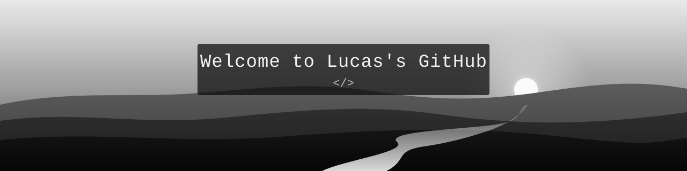
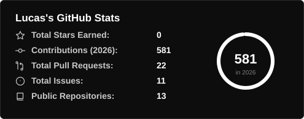
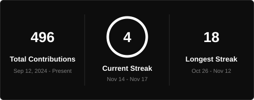
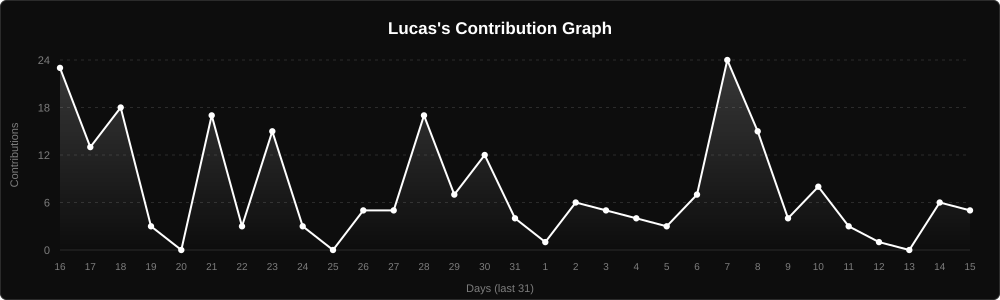
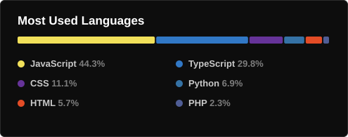

  

  
  

<h2 align="center"> About me</h2>

Hello there! I'm **_Lucas Abella_**, a Systems Analysis and Development student. I like building things for the web, designing APIs and figuring out the mechanics behind digital games.

   <i><b>Studying Systems Analysis and Development</b></i> 
   <i><b>Web development and APIs</b></i> 
   <i><b>Digital game mechanics</b></i> 
   <i><b>lucasabellamacedo@gmail.com</b></i>

 

<h2 align="center">Technologies</h2>

  
  
  
  
  
  
   
  
  
  
  
  
  
  

<h2 align="center"> Statistics</h2>

  
  

  

  

